<h1 align="left">Hi , I'm Samuel Gómez</h1>

**Junior Software Developer** focused on backend development and API design.

I build robust, scalable services, mainly with Java and Spring Boot, and I care about clean architecture, design patterns and maintainable code. Before graduating I completed internships at software consultancies, the last one working on an AI project at BBVA.

I'm currently expanding my skill set with new technologies, with a particular focus on how to integrate AI into real-world software.

  

---

## Tech Stack

**Languages**

  
  
  
  
  
  

**Frameworks & Tools**

  
  
  
  
  
  
  

**APIs**

  
  
  

**Databases**

  
  
  
  

---

## Current Focus

- **Backend engineering:** designing and deploying secure, efficient RESTful APIs, and deepening my knowledge of software architecture and design patterns.
- **AI integration:** learning how to build applications on top of large language models, including Retrieval-Augmented Generation (RAG), embeddings and vector search, and prompt design.
- **AI-assisted development:** using modern AI coding tools in my daily workflow while keeping a strong focus on code quality and sound engineering practices.
- **Side project:** building a RAG-based assistant for managing technical documentation and knowledge.

---

## GitHub Stats

  
  

